<div align="center">

<!-- HERO BANNER -->
<a href="https://www.mdfaisalahmed.info">
  
</a>

<!-- ANIMATED DYNAMIC TYPING SUBTITLE -->
<a href="https://www.mdfaisalahmed.info">
  
</a>

<p align="center">
  📍 Dhaka, Bangladesh 🇧🇩 &nbsp;·&nbsp; 🌐 <a href="https://www.mdfaisalahmed.info"><b>www.mdfaisalahmed.info</b></a> &nbsp;·&nbsp; 💼 <a href="https://linkedin.com/in/mdfaisalahmed025"><b>LinkedIn</b></a>
</p>

<!-- ACTION BADGES -->
<p align="center">
  <a href="https://www.mdfaisalahmed.info"></a>
  <a href="https://linkedin.com/in/mdfaisalahmed025"></a>
  <a href="https://leetcode.com/u/thenoobfaisal/"></a>
  <a href="https://ieeexplore.ieee.org/document/10269919"></a>
  <a href="mailto:mdfaisalahmed025@gmail.com"></a>
</p>

<!-- PROFILE VIEWS -->
<p align="center">
  
</p>

---

</div>

###  About Me

I am an **AI & Agentic Engineer** and **Backend Specialist** currently engineering high-concurrency booking engines and scalable travel tech platforms at **[TripFindy](https://www.mdfaisalahmed.info)**. I bridge cutting-edge research with production reality: authoring peer-reviewed NLP research published at **IEEE** (98.87% accuracy) while architecting autonomous agentic workflows, multi-turn reasoning pipelines, and enterprise-grade distributed backends.

```typescript
const faisalAhmed = {
  pronouns: "he/him",
  role: "AI & Agentic Engineer · Travel Tech & Backend Specialist",
  organization: "TripFindy (Software Engineer L1)",
  education: "B.Sc. in Computer Science & Engineering @ North South University (First Class Honours)",
  research: "Published at IEEE (Bangla Hate Speech Detection using BERT & GRU — 98.87% accuracy)",
  coreExpertise: [
    "Autonomous LLM Agents, Multi-turn Reasoning & Tool-calling",
    "Global Distribution Systems (Sabre, Galileo, Amadeus) & NDC / LCC Airline APIs",
    "High-Concurrency Travel Booking Engines & Microservices (Node.js, NestJS, Python, GCP)"
  ],
  currentFocus: "Architecting autonomous travel agents with live tool-calling and real-time PNR ticketing",
  openTo: ["High-Impact AI / Agentic Roles", "Travel Tech System Architecture", "Production Consulting"]
};
```

---

### 🧠 Areas of Specialization

<table>
  <tr>
    <td width="33%" valign="top">
      <h4 align="center">🤖 AI & Agentic Systems</h4>
      <ul>
        <li>Autonomous LLM Agents & Tool Execution</li>
        <li>Multi-Turn Reasoning & Task Planning</li>
        <li>RAG (Retrieval-Augmented Generation)</li>
        <li>Transformers (BERT, RoBERTa, Hugging Face)</li>
        <li>Computer Vision (PyTorch, ResNet34)</li>
        <li>High-Accuracy Text Classification & NLP</li>
      </ul>
    </td>
    <td width="33%" valign="top">
      <h4 align="center">✈️ Travel Tech & GDS</h4>
      <ul>
        <li>Sabre, Galileo & Amadeus GDS Integration</li>
        <li>LCC & NDC Airline Direct Connect APIs</li>
        <li>High-Concurrency Flight & Hotel Booking Engines</li>
        <li>Automated Ticketing & Fare Rule Processing</li>
        <li>B2B Agent Portals & B2C Booking Platforms</li>
        <li>Dynamic Markups & Currency Management</li>
      </ul>
    </td>
    <td width="33%" valign="top">
      <h4 align="center">⚙️ Backend & Cloud Architecture</h4>
      <ul>
        <li>Node.js, NestJS & Express Microservices</li>
        <li>Clean Architecture & Domain-Driven Design</li>
        <li>Google Cloud Platform (GCP) & Docker CI/CD</li>
        <li>Database Schema Design & Query Optimization</li>
        <li>Fintech Gateways (SSLCommerz, bKash, Nagad)</li>
        <li>JWT Authentication & Role-Based Access Control</li>
      </ul>
    </td>
  </tr>
</table>

---

### 🏗️ Architecture & Engineering Deep Dives

<details>
<summary><b>🛫 Deep Dive: High-Concurrency Travel Booking Engine (GDS / NDC Architecture)</b> <i>(Click to expand)</i></summary>
<br/>

```
[B2B / B2C Clients] ──► [API Gateway / Rate Limiting]
                                │
       ┌────────────────────────┴────────────────────────┐
       ▼                                                 ▼
[Fare Search & Rules Engine]                    [User Auth / JWT & RBAC]
  ├─ Distributed Cache (Redis)
  ├─ Dynamic Markup & Currency Conversion
  │
  ▼
[GDS & Direct Connect Aggregator]
  ├── Sabre GDS (SOAP / REST)
  ├── Galileo / Travelport GDS
  ├── Amadeus GDS
  └── NDC & LCC Airline Direct Connect APIs
       │
       ▼
[Booking & Order Management] ──► [Fintech Payment Gateways]
  ├─ PNR Creation & Validation     ├── SSLCommerz
  ├─ Automated Fare Quotation      ├── bKash / Nagad / AmarPay
  └─ Automated E-Ticket Issuance   └── International Cards
```

- **Concurrency & Resilience**: Distributed caching with Redis to eliminate redundant GDS API calls, sub-second fare aggregation across multiple suppliers, and exponential backoff retry mechanisms.
- **Fail-safe Ticketing**: Two-phase commit logic ensuring payment settlement prior to PNR issuance, preventing orphaned tickets or payment discrepancies.

</details>

<details>
<summary><b>🤖 Deep Dive: Autonomous LLM Agent Workflow (Multi-Turn Tool Execution)</b> <i>(Click to expand)</i></summary>
<br/>

```
[User Input / Query]
       │
       ▼
[Task Planner & Intent Classifier]
  ├─ Conversation Memory (Short-Term & Long-Term Context)
  ├─ Tool Selection & Schema Validation
  │
  ▼
[Autonomous Execution Loop]
  ├─ Tool: Live API Integration (Flight / Product / CRM)
  ├─ Tool: Database Query / RAG Vector Store Retrieval
  ├─ Tool: Calculation & Negotiation Engine
  │
  ▼
[Self-Reflection & Response Synthesizer]
  ├─ Output Verification & Constraint Checking
  └─ Final Grounded Response / Autonomous Transaction
```

- **Tool Execution & Grounding**: Strict JSON schema contracts with zero-hallucination constraints for real-time transactional actions (e.g., live flight queries, sales negotiation, and database mutation).

</details>

<details>
<summary><b>🔬 Deep Dive: IEEE-Published NLP Research (98.87% Accuracy)</b> <i>(Click to expand)</i></summary>
<br/>

- **Publication Title**: *Bangla Hate Speech Detection Using Transformer-Based NLP & Deep Learning*
- **Conference**: 2023 3rd Asian Conference on Innovation in Technology (IEEE-indexed).
- **Core Architecture**:
  - Multilingual transformer embeddings (Fine-tuned BERT) capturing complex Bengali morphological nuances.
  - Bidirectional Gated Recurrent Units (Bi-GRU) paired with self-attention mechanisms to prioritize toxic sequence markers.
  - Achieved **98.87% classification accuracy**, outperforming standard baseline architectures.
- 👉 **[Read on IEEE Xplore](https://ieeexplore.ieee.org/document/10269919)**

</details>

---

### 📡 Live Engineering Radar

```
🔭 Currently Building : Autonomous AI Travel Agent with multi-turn tool calling and PNR booking capabilities
⚡ Deeply Exploring   : Multi-Agent Systems (LangGraph, CrewAI), Local LLM Inference (vLLM, Ollama), Small SLM Fine-Tuning
🎯 System Goal        : Architecting zero-downtime booking microservices capable of 10,000+ queries/minute
🌱 Reading & Research : Advanced Agentic Patterns, Tool Use benchmarks, and Low-Latency RAG architectures
```

---

### 🛠️ Tech Stack & Tooling

<div align="center">

<!-- SKILL ICONS DISPLAY -->
<p align="center">
  
</p>

</div>

<div align="left">

#### 🤖 AI, Machine Learning & NLP


#### ✈️ Travel Tech & Enterprise Integrations


#### ⚙️ Backend & Languages


-F7DF1E?style=flat-square&logo=javascript&logoColor=black)


#### 🗄️ Databases & Caching


#### ☁️ Cloud, DevOps & Security
-4285F4?style=flat-square&logo=google-cloud&logoColor=white)


#### 💳 Fintech, Auth & Security


</div>

---

### 🚀 Featured Projects

| Project | Description | Stack | Link |
| :--- | :--- | :--- | :--- |
| **[AI Sales Agent](https://github.com/mdfaisalahmed025/ai-sales-automation)** | Autonomous LLM-powered sales bot with multi-channel messaging and intelligent negotiation capabilities. | `Python` `LLM` `Agents` | [GitHub](https://github.com/mdfaisalahmed025/ai-sales-automation) |
| **[AI Agent Chatbot](https://github.com/mdfaisalahmed025/AI-agent-chatbot)** | Conversational AI chat assistant with multi-turn dialogue memory and autonomous tool invocation. | `Python` `LLM` `LangChain` | [GitHub](https://github.com/mdfaisalahmed025/AI-agent-chatbot) |
| **[Bangla Hate Speech Detection](https://github.com/mdfaisalahmed025/Bangla-Hate-Speech-Detection-Using-NLP)** | Transformer & GRU deep learning system achieving **98.87% accuracy** on Bengali text; peer-reviewed & IEEE-published. | `BERT` `GRU` `PyTorch` | [GitHub](https://github.com/mdfaisalahmed025/Bangla-Hate-Speech-Detection-Using-NLP) · [Paper](https://ieeexplore.ieee.org/document/10269919) |
| **[Multi-Label News Classification](https://github.com/mdfaisalahmed025/Multi-Label-Topic-Classification-of-News-Articles)** | RoBERTa transformer pipeline classifying 92,000+ news articles across 12 topics simultaneously. | `RoBERTa` `Transformers` `NLP` | [GitHub](https://github.com/mdfaisalahmed025/Multi-Label-Topic-Classification-of-News-Articles) |
| **[Flyfar-Ladies Platform](https://www.flyfarladies.com/)** | Live production backend powering Bangladesh's premier women-centric travel & lifestyle platform. | `NestJS` `MySQL` `REST API` | [Live Site](https://www.flyfarladies.com/) |
| **[Inception Games Backend](https://www.inception.games/)** | Production backend for a live esports platform on GCP (Cloud SQL, GCS, App Engine CI/CD via Cloud Build). | `Node.js` `Express` `GCP` | [Live Site](https://www.inception.games/) |
| **[Electronic Component Recognizer](https://github.com/mdfaisalahmed025/Electronic-Component-Recognizer)** | ResNet34 computer vision classifier identifying 20 electronic component categories with 97% accuracy. | `PyTorch` `ResNet34` `CV` | [GitHub](https://github.com/mdfaisalahmed025/Electronic-Component-Recognizer) |
| **[Global University Insights](https://github.com/mdfaisalahmed025/Global-University-Insights)** | Automated data scraping and analytics engine exploring global tuition, admission trends, and rankings. | `Python` `Pandas` `Scraping` | [GitHub](https://github.com/mdfaisalahmed025/Global-University-Insights) |
| **[Image Editor Desktop App](https://github.com/mdfaisalahmed025/image-editor-with-opencv-and-tkinter)** | Desktop application featuring 10+ real-time image processing operations (blur, edge detection, rotation). | `Python` `OpenCV` `Tkinter` | [GitHub](https://github.com/mdfaisalahmed025/image-editor-with-opencv-and-tkinter) |

---

### 📄 Research & Publications

- **Bangla Hate Speech Detection Using Transformer-Based NLP & Deep Learning**  
  *Published in: 2023 3rd Asian Conference on Innovation in Technology (IEEE)*  
  Fine-tuned BERT combined with GRU and Attention Mechanisms to achieve **98.87% accuracy** on multilingual Bangla text classification.  
  👉 **[Read on IEEE Xplore](https://ieeexplore.ieee.org/document/10269919)**

- **Project Schedule Delays & Circular Socio-Economic Impacts**  
  *Published in: International Journal of Management and Applied Science (IJMAS)*  
  Case study on major infrastructure developments (Dhaka Metro Rail & Padma Bridge) analyzing cascading socio-economic effects of project delays.  
  👉 **[Read Paper on IJMAS](https://iraj.doionline.org/dx/IJMAS-IRAJ-DOIONLINE-20780)**

---

### 💼 Experience

- **Software Engineer (L1)** @ **TripFindy** *(Aug 2026 — Present)*
  - Engineering high-concurrency booking engines and end-to-end travel agency platforms.
  - Integrating GDS systems (Sabre, Galileo, Amadeus) and direct NDC/LCC airline feeds for high-availability booking infrastructure.
  - Designing scalable travel management APIs, automated ticketing, and dynamic pricing systems.

- **Junior Software Engineer** @ **Inception Games** *(Apr 2026 — Aug 2026)*
  - Built backend services and RESTful APIs for a live GCP-deployed esports platform.
  - Managed Cloud SQL databases, GCS uploads, and CI/CD pipelines via Cloud Build and App Engine.
  - Integrated local and international payment systems and built administrative management tools.

- **Junior Back-End Engineer** @ **Fly Far Tech** *(Jan 2023 — Jan 2025)*
  - Engineered production RESTful APIs with Node.js and NestJS powering high-traffic travel systems.
  - Integrated Sabre, Galileo, and Amadeus GDS, along with LCC and NDC airline APIs for B2B/B2C portals.
  - Built payment integrations for SSLCommerz, AmarPay, bKash, and Nagad with JWT RBAC security.

- **Research Assistant — NLP** @ **North South University** *(Jan 2024 — Jul 2024)*
  - Developed deep learning models for Bangla hate speech detection using GRU and BERT, achieving 98.87% accuracy.
  - Published research findings in an IEEE-indexed international conference proceeding.

---

### 🐍 GitHub Contribution Snake Animation

<div align="center">

<picture>
  <source media="(prefers-color-scheme: dark)" srcset="https://raw.githubusercontent.com/mdfaisalahmed025/mdfaisalahmed025/output/github-contribution-grid-snake-dark.svg">
  <source media="(prefers-color-scheme: light)" srcset="https://raw.githubusercontent.com/mdfaisalahmed025/mdfaisalahmed025/output/github-contribution-grid-snake.svg">
  
</picture>

</div>

---

### 📊 GitHub Activity & Statistics

<div align="center">


<br/>


</div>

---

### 📫 Connect With Me

<div align="center">

[](https://www.mdfaisalahmed.info)
[](https://linkedin.com/in/mdfaisalahmed025)
[](https://leetcode.com/u/thenoobfaisal/)
[](mailto:mdfaisalahmed025@gmail.com)
[](https://wa.me/8801868984364)

<br/>

*💬 Open for AI & Agentic roles, Travel Tech architecture consultations, and scalable backend engineering opportunities.*

<!-- FOOTER BANNER -->
<a href="https://www.mdfaisalahmed.info">
  
</a>

</div>
